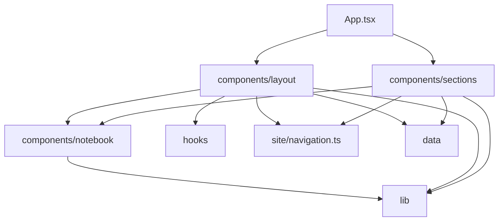

# Architecture

A static, single page React 19 + TypeScript + Vite + Tailwind CSS 4 site. No backend, database, environment variables, or runtime API calls. The build output (`dist`) is plain static files. Setup and commands are in [README.md](README.md); visual rules are in [DESIGN.md](DESIGN.md).

## Module map

| Module                                   | Responsibility                                                                    | Public API                                               |
| ---------------------------------------- | --------------------------------------------------------------------------------- | -------------------------------------------------------- |
| `index.html`                             | Metadata, fonts, theme bootstrap before React, `#root`.                           | Static document                                          |
| `src/main.tsx`                           | Mounts React into `#root`.                                                        | Entry point                                              |
| `src/App.tsx`                            | Composes navigation and sections in page order.                                   | `App`                                                    |
| `src/data`                               | All portfolio content and its types.                                              | `src/data/index.ts`                                      |
| `src/site/navigation.ts`                 | Section anchors, labels, and icons in page order; page eyebrows; logo path.       | `navSections`, `navSectionIds`, `pageEyebrow`, `logoUrl` |
| `src/components/layout`                  | Page chrome. `SiteNavigation` owns the skip link and the one section observer.    | `SiteNavigation` (used by `App`); `TopNav`, `BottomNav`  |
| `src/components/sections`                | One file per page section; `ProjectCard` belongs to `Projects`.                   | One component per file                                   |
| `src/components/notebook`                | Content-free UI primitives of the notebook design system.                         | `src/components/notebook/index.ts`                       |
| `src/hooks`                              | Browser state: persisted theme, active section observer, scroll offset.           | `useTheme`, `useActiveSection`, `useScrolled`            |
| `src/lib`                                | Framework-free helpers: class merging, new-tab link attributes.                   | `cn`, `newTabLinkProps`                                  |
| `src/styles.css`                         | Tailwind setup, theme tokens, base styles, notebook classes.                      | CSS classes and utilities                                |
| `scripts/dev.mjs`                        | `npm run dev` launcher.                                                           | CLI                                                      |
| `*.test.ts`, `*.test.tsx` (next to code) | Vitest tests run in jsdom: page structure and links, disclosure, link attributes. | `npm test`                                               |



## Dependency rules

Enforced by `npm run arch` ([.dependency-cruiser.cjs](.dependency-cruiser.cjs)); CI fails on any violation.

```text
App      -> layout, sections
layout   -> notebook, hooks, site, data, lib
sections -> notebook, data, site, lib
notebook -> lib only
hooks    -> (react only)
site     -> (icons only)
data, lib -> nothing inside src
```

- No cycles and no orphan modules.
- Sections never import other sections or layout, except `Projects` -> `ProjectCard`.
- Everything outside `src/components/notebook` imports primitives through its `index.ts`.

Duplicate code in `src` (TS, TSX, CSS, tests included) is blocked by `npm run dupes` (jscpd, threshold 0, 40 tokens, 4 lines).

## Where new code goes

- New or changed content: `src/data` only, including hero figures, focus areas, About notes, and contact links. Add or change the type in `types.ts` first. Section headings and one-line annotations stay in their section component.
- New page section: a file in `src/components/sections` wrapped in `PaperSheet`, an entry in `navSections` (which also numbers its `// page n` eyebrow through `pageEyebrow`), and one line in `App.tsx`.
- New entry with a summary and points (project, role): extend `Highlighted` in `types.ts` and render it with the `Highlights` primitive.
- New reusable visual element: `src/components/notebook`, exported from `index.ts`, receiving content through props.
- New browser behaviour (storage, observers, scroll, media queries): a hook in `src/hooks`.
- New pure helper: a file in `src/lib` named by responsibility. No `utils`, `helpers`, or `common` files.
- New colour, font, or type size: a token or class in `src/styles.css`, recorded in [DESIGN.md](DESIGN.md). Theme differences go in the token blocks, never in `[data-theme="light"] .class` overrides.
- Tests: next to the code as `*.test.ts(x)`; `npm test` runs them and `npm run check` includes it.

## Decisions

- **Single package, layered folders.** The site is about 1,800 lines across 30 source files (`npm run dupes`). A monorepo or feature packages would add ceremony without benefit.
- **Navigation defined once.** `TopNav` and `BottomNav` both read `navSections`, which carries a full and a short label. The section eyebrows (`// page n`) are derived from the same order, so reordering sections renumbers them.
- **One section observer.** `SiteNavigation` calls `useActiveSection` once and passes the result to both navs, which mark the current section with `aria-current="location"`.
- **Anchors, not scripted scrolling.** Both navs are plain `#id` links. Smooth scrolling and its reduced motion fallback come from CSS, so no JavaScript decides scroll behaviour.
- **One disclosure pattern.** Projects and experience entries share the `Highlighted` data shape (summary plus points) and the `Highlights` primitive (always-visible summary, points behind a button with `aria-expanded` and `aria-controls`).
- **Calls to action are links.** Every button-styled element navigates, so the primitive is `ButtonLink`, an anchor only. Add a separate button primitive if an action ever needs one.
- **Hooks for side effects.** Theme persistence, section observation, and scroll offset live in hooks so components only render. Storage access is wrapped in `try`, so blocked storage only loses persistence.
- **One rule for link targets.** `newTabLinkProps` decides whether a link opens a new tab, so every off-page link behaves the same; a test checks every rendered link.
- **Characterisation tests.** The tests render the whole `App` to static markup and check sections, anchors, link targets, accessible names, and content, so structural refactors are caught. They were added before this structure was changed.
- **No environment config.** Nothing is configurable per environment, so there is no `.env.example`.
- **One launcher.** `npm run dev` runs `scripts/dev.mjs`, which installs on lockfile change, fails fast on an unsupported Node version or a busy port, runs Vite with `--strictPort`, and kills the process tree on Ctrl+C. There is only one long-running process, so no extra terminal windows are opened.

## Allowed duplication

- `index.html` inline theme script repeats the `portfolio-theme` key and theme values from `src/hooks/useTheme.ts`. It must run before React loads to avoid a theme flash, so it cannot import the module.
- `index.html`, `public/robots.txt`, and `public/sitemap.xml` each contain the canonical site URL; they are static files served as is. The description text is repeated in the `index.html` meta, Open Graph, Twitter, and JSON-LD tags for the same reason.
- The dark and light theme blocks in `src/styles.css` share token names by design; values differ.
- The Node version range appears in `package.json` `engines` and in the check inside `scripts/dev.mjs`.
- Test files repeat literal expected values (attribute values, labels) on purpose.

## Known gaps

- Content is kept by hand in sync with external sources (resume, LinkedIn). Nothing checks that the hero figures still match the experience and project text.
- No unused CSS detection: neither jscpd nor dependency-cruiser checks for classes no component uses. The October 2026 pass removed all dead rules found by hand.

## Growth signals for the next pass

- Content edits by non-developers, or more than about 15 projects: move content to Markdown or MDX, or a headless CMS.
- More than one page or deep links: add a router and move to `src/features/<page>` folders.
- Any logic beyond rendering (filtering, search, forms): add Testing Library on top of the existing Vitest setup, with tests next to the code.
- Any runtime config (analytics, API keys): add validated `import.meta.env` config in `src/config.ts` and `.env.example`.
- JS bundle over about 300 kB gzip (currently 79.73 kB): lazy load sections below the fold.
